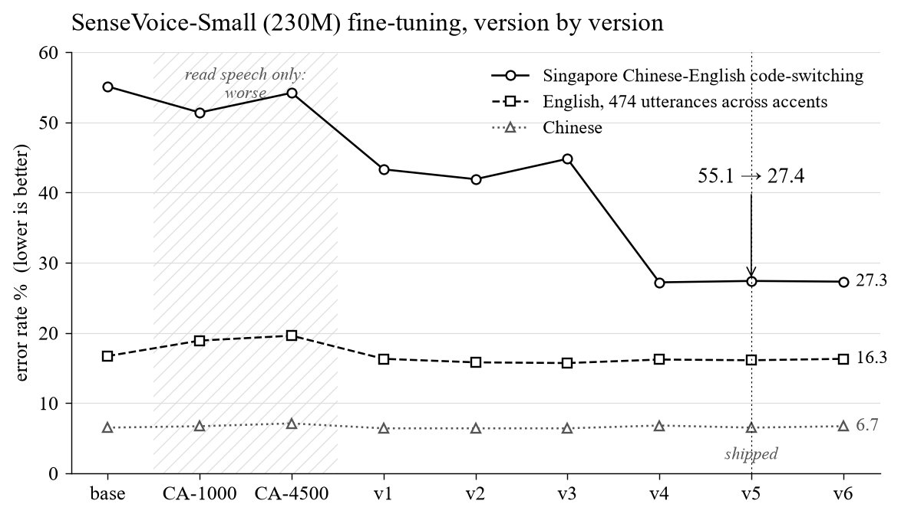
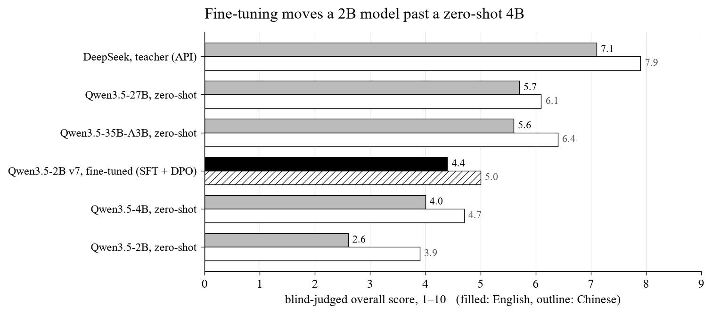
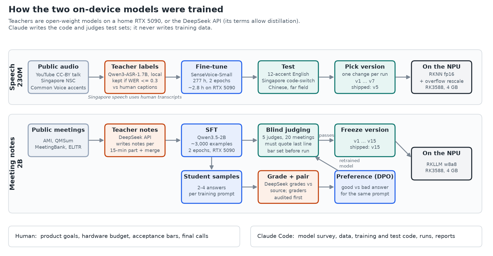
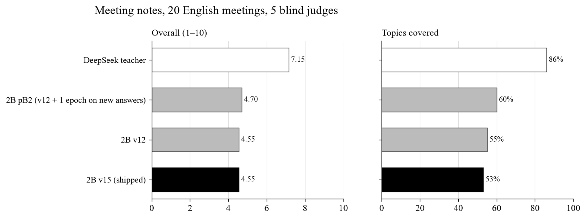
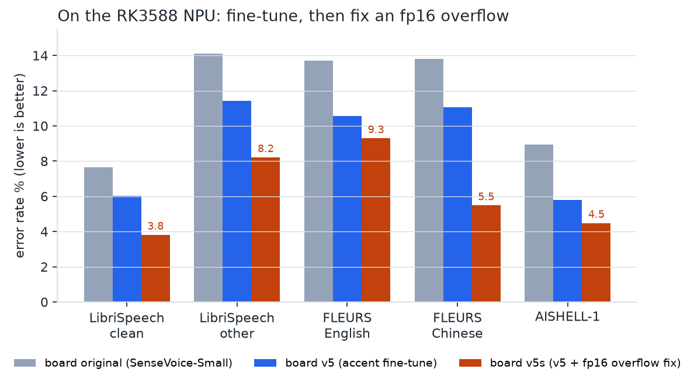

# VoiceCard Offline

**An AI agent trained the small models in this repo.** One engineer set the product goals, the hardware budget and the acceptance bars. Claude Code (Anthropic's coding agent) did the engineering: it picked the models, built the test sets and data pipelines, wrote the training and evaluation code, ran 20+ training runs on a home RTX 5090, and ported the result to a 4 GB RK3588 board. None of the training data comes from Claude (see [Clean provenance](#clean-provenance)).

The product: an offline meeting recorder. Speech recognition and meeting notes run on a small NPU, with no cloud, no app and no subscription. It is built for Singapore-style Chinese-English code-switching.

## Results at a glance

| What | How | Result |
|---|---|---|
| Speech recognition, 230M params, on the NPU | SenseVoice-Small fine-tuned on 277 h of public speech; English labelled by an open-weight teacher (Qwen3-ASR-1.7B), Singapore speech from human transcripts | Singapore code-switching error **55.1% → 27.4%**; English and Chinese held level |
| The same model on the RK3588 board | Found and fixed an fp16 overflow inside the encoder (exact rescale, no retraining) | LibriSpeech clean **7.7% → 3.8%**, AISHELL-1 **8.9% → 4.5%** |
| Meeting notes, 2B params, on the NPU | Qwen3.5-2B distilled from a DeepSeek teacher (supervised fine-tuning, plus preference training in some versions); 15 versions | Blind-judged **2.6 → 4.4** (English) vs the untrained 2B, ahead of an untrained 4B (4.0); the teacher scores 7.1 |
| End to end on a dev board | Orange Pi 5 (RK3588S, 4 GB), everything offline | 39-minute meeting → notes in 20 minutes |





Every number links back to a CSV in [`results/`](results/) (opens in Excel) and to the script that produced it. Failures are reported with the same detail as successes.

## Clean provenance

Small models are usually trained on the outputs of a big one. Which big one matters:

- **Claude is never the teacher.** Anthropic's consumer terms (section 3) do not allow using the service to develop or train AI models. Claude wrote code, designed experiments and graded small held-out test sets as a blind judge. It never produced a single training example.
- **Speech teacher: Qwen3-ASR-1.7B** (Apache-2.0), run locally on the RTX 5090. Its labels on YouTube CC-BY speech are kept only when they agree with the human captions (WER ≤ 0.3); 79% passed on the first shard. Singapore speech uses the human transcripts of IMDA's National Speech Corpus (Singapore Open Data Licence).
- **Notes teacher: DeepSeek API.** DeepSeek's terms of use (updated 2026-03-27, §4.2(3)) explicitly allow using outputs to train other models, including distillation. Only public meeting datasets (AMI, QMSum, MeetingBank, ELITR) were sent. The English training set for v12 cost $2.67. Early versions used open-weight teachers (Qwen3.5, Gemma 4) on the 5090.

## How it was trained



**Choosing models.** Before training anything, 12 open speech models were tested on English accents ([accent test](docs/accent-test.md)) and on Singapore speech ([Singapore test](docs/singapore-asr.md)). SenseVoice-Small was not the most accurate, but it is a CTC model (it never loops or switches language mid-sentence), runs at 12× real time on a laptop CPU and has mature NPU support. For notes, 7 teacher candidates and 3 student sizes were blind-judged on 20 meetings first; the 2B student was chosen because it is the largest that fits the 4 GB board (the NPU only supports 8-bit weights there).

**Notes in two passes.** A 2B model cannot read an hour-long transcript at once. The board writes notes for each ~15-minute part, then merges them. Both steps are distilled.

## What is different about the method

The algorithms are standard (pseudo-labelling, SFT, DPO). What is different is who did the work and how it was kept honest.

1. **An AI ran the project; a human set the bars.** The human decided what the product is, the hardware budget, English first, and what counts as good enough. Everything else was proposed, run and reported by the agent.
2. **Acceptance bars are set before the run.** Each experiment states its hypothesis, metric and minimum detectable effect first. Example: with 20 meetings, a blind judge can only detect about a 1-point change in overall score, so smaller claims are not made.
3. **Every grader is audited before it is trusted.** An automatic grader (DeepSeek) once flagged 19 "severe errors" in student notes; a manual check found 0 of them were real. Since then, graders are spot-checked against the source before their verdicts drive training. Blind judges must quote the last line of each transcript to prove they read it.
4. **Control arms.** Changing the teacher's rules for what counts as "decided" was tested as A (old answers) vs B (new answers), same steps, same data size: +12.0 points [+5.0, +19.9] on decided items. The control itself drifted 5.5 points between runs, which is reported too.
5. **One change at a time.** That is how the speech runs found that simulated far-field audio did not help (v4 vs v5) and that adding more YouTube data did not bring back English (v6).





## What did not work

- Training speech on read speech only made English worse (16.7 → 19.6).
- Adding 10× more English conversation stopped helping at 235 h and diluted code-switching (41.9 → 44.8).
- Simulated far-field audio did not improve real meeting-room audio.
- Preference pairs that differ in only a few sentences (v8) made the model loop; it was dropped.
- The 2B notes are still well below the teacher (4.55 vs 7.15): coverage 53% vs 86%. Capacity is one cause: the same recipe on Qwen3.5-4B scored +1.44 higher [+0.67, +2.22] over 18 meetings, mostly on Chinese, but 4B does not fit this board.

## Status (November 2026)

| Part | State |
|---|---|
| Speech recognition on the NPU | Works |
| Meeting notes on the NPU | Works, quality well below a large model |
| End to end on a dev board | Works on recorded audio |
| Live microphone | Dev-board microphone not usable at meeting distance; product design uses two digital MEMS microphones |
| Custom board, enclosure, battery | Not started |

## Write-ups and code

Published in batches. Every result above is in `results/` now; the training code follows in batches 2–4.

1. **Accent tests** (this release, with code)
   - [Singapore English: Whisper outputs Malay](docs/singapore-asr.md)
   - [English accent test: 12 open speech-recognition models](docs/accent-test.md)
2. Distilling accent coverage into a 230M model (7 versions)
3. Running it on an RK3588: the fp16 overflow behind empty transcripts, and the end-to-end demo
4. Teaching a 2B model to write meeting notes: 15 versions, the failures, and the rules that came out of them
5. Custom board and enclosure

## Layout

- `bench/` scripts: build test sets from public datasets, run models, score
- `results/` every number in this README, as CSV
- `tools/make_charts.py` redraws the charts from `results/`; `tools/make_flow.py` draws the pipeline diagram
- `docs/` write-ups

Datasets are not redistributed. Each script downloads its data from the original source, under that dataset's licence.

## Running the accent test

```
cd bench
python -m venv .venv
.venv/Scripts/pip install faster-whisper pyarrow soundfile huggingface_hub whisper-normalizer sherpa-onnx
python prep_en.py                       # samples the 474-utterance test set into data/eval_en/
```

Then run one model family per script, with `EVAL_SUITE=en` set so results go to `results_en/`:

- `run_sherpa.py <model> <tag> [threads]`: sherpa-onnx int8 on CPU (Parakeet, Moonshine, Canary, X-ASR, Qwen3-ASR int8). Download the matching sherpa-onnx model into `bench/models_sherpa/` first; the folder names are in the script.
- `run_fw.py <model> <tag> en`: faster-whisper on GPU.
- `run_qwen.py`, `run_qwen_guard.py`, `run_sensevoice_gpu.py`, `run_granite.py`, `run_hf2.py`: Hugging Face models on GPU.

Score: `python score_en.py --region results_en/*.jsonl`

## Licence

Code: Apache-2.0 (see `LICENSE`). Model weights, when released, keep the licence of the model they were fine-tuned from (SenseVoice: FunASR model licence; Qwen: Apache-2.0).
